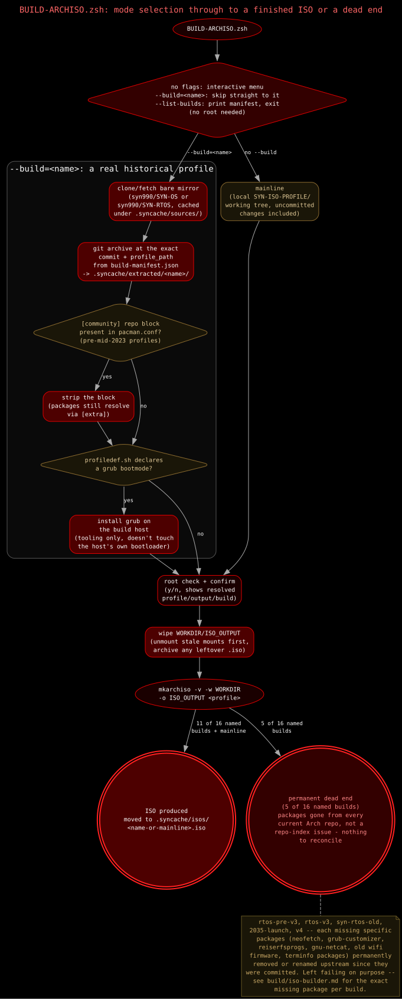
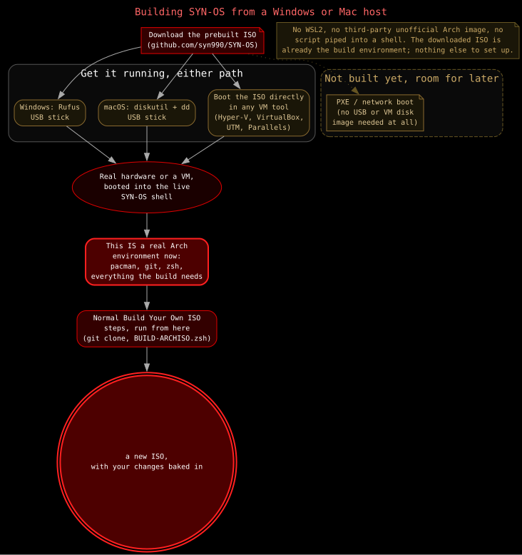

# Building your own ISO

Want to build SYN-OS yourself instead of downloading it? One script does
the whole thing.



```bash
sudo pacman -S archiso git
git clone https://github.com/syn990/SYN-OS.git
cd SYN-OS
sudo zsh ./BUILD-ARCHISO.zsh
```

Run it with no options and you'll get a menu. The first choice is always
today's version, everything currently in the project. The finished ISO
lands in `ISO_OUTPUT/`.

## Editions: every way of building it

SYN-OS can be built more than one way: on Arch Linux with pacman, or on
Linux From Scratch, with SYN-OS's own base and kernel under runit and the
desktop either taken from Void Linux's packages or compiled from source.
Each way is an edition, one plain file in `SYN-EDITIONS/` that says what
to build, the same way `synos.conf` says how to install:

```bash
zsh BUILD.zsh                     # the editions there are
zsh BUILD.zsh check syn-os-lfs    # checks everything first, says what would run
zsh BUILD.zsh syn-os-lfs          # builds it
zsh BUILD.zsh status syn-os-lfs   # how far its build has got
```

Nothing asks you anything once it starts: every answer is in the
edition's file, and the check lists every problem it finds before
anything runs. To make a new edition, copy one of the files and change
it. An edition needn't even be SYN-OS: `arch-releng` builds Arch's own
installation ISO, archiso's releng profile exactly as it ships, with
`LayerStrat="none"` (no SYN layer) and the profile's path in `Profile`.

The ISO Builder app opens on the editions: every one is listed at the
top, with how far its build has got (an LFS one's steps, each one's
newest ISO). Enter makes one the target, and Launch builds it. An Arch
edition builds there like any profile. An LFS one runs in the same build
window, from the first step not done yet. An LFS build takes hours the
first time; if it stops, launch it again and it carries on from the step
that stopped. It runs doas for its disk image, so the app only starts it
when doas doesn't need your password; otherwise run
`zsh BUILD.zsh syn-os-lfs` in a terminal.

## Building an older version

As a bit of a curiosity, this same script can also reach back into the
project's own history and build one of its past editions exactly as it
shipped at the time, going all the way back to 2021. Pick one from the
same menu, or use `--build=<name>` to jump straight to it.

Not every old edition still builds today. Some depended on packages that
no longer exist anywhere in Arch's repositories and simply can't be
built anymore, that's a fact of software aging, not a bug in this
script.

## Building without a Linux machine

You do need a real Arch environment to run the build script itself,
Windows and macOS can't run it directly. But the SYN-OS ISO you'd
download already is that environment. Boot it in a VM (Hyper-V,
VirtualBox, UTM, whatever you've got), clone the project, and build from
inside that live session.


