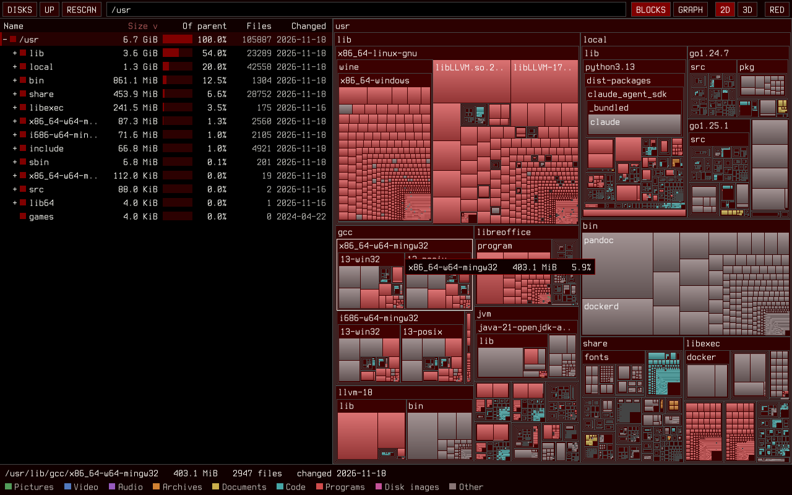
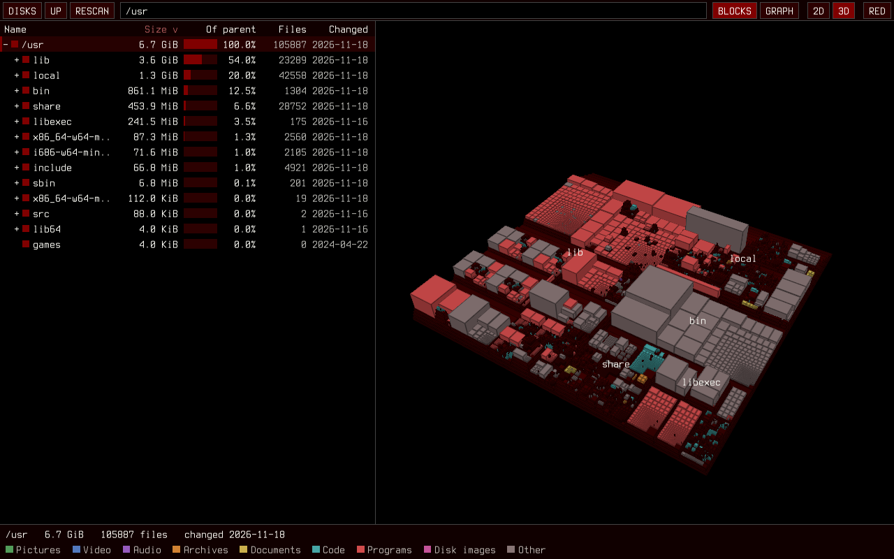
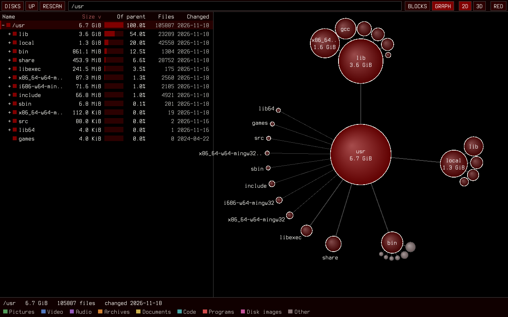
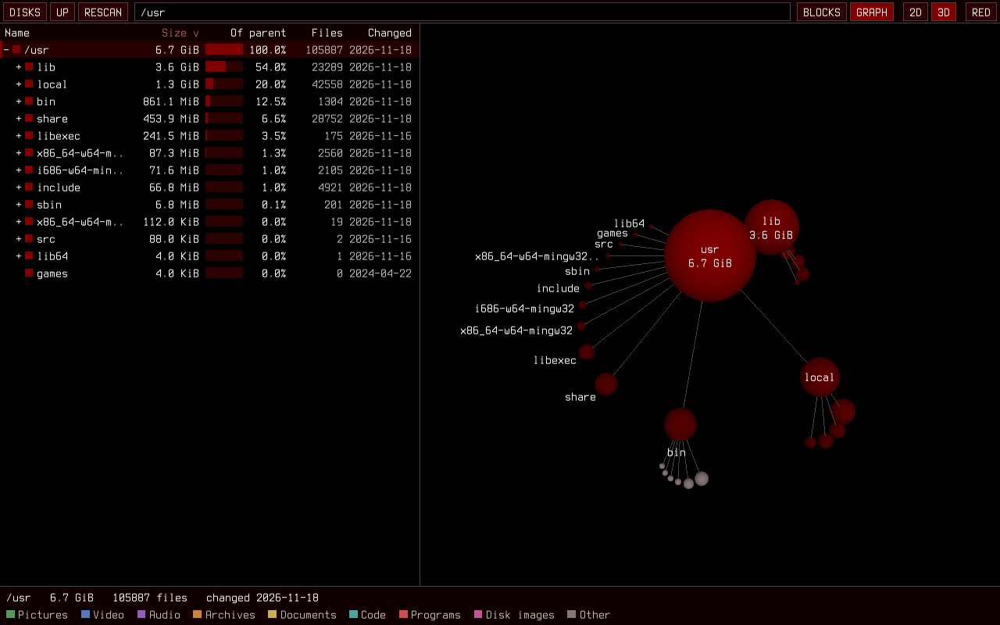

# syn-dirstat

Where the space on a disk has gone, on Linux and Windows. It scans a
disk, a folder or a mounted network share and shows it three ways at
once: a tree list that sorts by any column, a block map where every file
is a rectangle as big as the space it takes, and a node graph of the
biggest folders that you walk into. The block map and the graph each
turn between 2D and 3D with one key. It wears the SYN-OS theme.

It is in the line of TreeSize, SequoiaView, KDirStat, WinDirStat and
QDirStat (the list and the block map), Filelight and Baobab (walking in
from the middle) and SGI's fsn (the 3D).

| | |
|---|---|
|  |  |
| The block map: folders are frames with their names, files are blocks coloured by kind | The same in 3D: folders are platforms, files stand on them, taller the bigger |
|  |  |
| The node graph: the focus in the middle, its biggest children round it, theirs behind them | The same in 3D: each level hangs below the last |

**It builds and runs on Linux. The Windows program compiles and links
(one `.exe`, no DLLs beside it) but has not been run on Windows yet.**
It stays `-wip`, out of the ISO builds, until it has been.

## Commands

```
syn-dirstat                  start at the list of disks
syn-dirstat PATH             scan PATH at once
syn-dirstat --graph PATH     start in the node graph, not the block map
syn-dirstat --3d PATH        start in 3D
syn-dirstat --theme NAME     wear this theme, e.g. SYN-OS-HALO-CYAN
syn-dirstat --dump PATH      print the tree as text, no window
syn-dirstat --depth N        how many levels --dump prints (default 2)
syn-dirstat --shot FILE.ppm  save the first picture (of PATH, or of the disks) and leave
```

## Using it

The first screen lists the disks and network shares the machine has
mounted, each with how full it is. Click one to scan it. Any other path
is typed into the bar (click it or Ctrl+L, then Enter; Ctrl+V pastes),
or a folder is dropped on the window.

**A remote path** is one the machine has mounted: an NFS, SMB or sshfs
mount on Linux, a mapped drive or a `\\server\share` path on Windows.
Mounted shares are in the disk list, marked NETWORK.

Then the list is on the left and the view on the right, and what is
selected in one is selected in the other.

| | |
|---|---|
| Tab, or BLOCKS / GRAPH | switch between the block map and the node graph |
| Space, or 2D / 3D | turn the view between flat and solid |
| click | select |
| double-click, or Enter on the selection | go into that folder: it becomes the whole view |
| right-click, Backspace, or UP | back up to the parent folder |
| drag, wheel (in 3D) | turn the view, zoom |
| click a column's heading | sort the list by it; again to turn the order round |
| arrows, Page Up / Down | move through the list; Right opens a folder, Left closes it |
| O | open the selection's folder in the file manager |
| R or F5 | scan again |
| T, Shift+T, or the theme's name | next theme, previous theme |
| Esc | stop a scan; back to the disks |

Hovering anything shows its name, size and share of the view; the bar at
the bottom has its whole path, file count and when it last changed.

Colours: a file's is its kind (pictures, video, audio, archives,
documents, code, programs, disk images, other), the key is at the bottom.
A folder in the graph is nearer the theme's accent the more of the
picture it holds. The selection is the theme's urgent colour.

It only reads. Nothing is deleted or moved from here.

## What a size is

- **Linux:** the space taken on disk (`st_blocks`), so a sparse file
  counts as what it really holds, and a folder's own blocks are counted.
  The total matches `du -s`. A file with several hard links is counted
  once per link (as `du -l`).
- **Windows:** the file's length, read from the folder's entries, which
  is what makes a scan fast.
- Symbolic links and Windows junctions are counted as themselves and
  never followed. A scan stays on the file system it started on: other
  disks mounted inside it are not walked.
- A folder that could not be opened is shown in the urgent colour and
  said in the bottom bar.

## How it's built

C11. SDL2 for the window and input, SDL2_ttf for text, OpenGL 3.3 for
everything drawn, flat or solid. No other library: the few OpenGL calls
newer than 1.1 are looked up through SDL (`src/gl.c`), and the matrix
math is `src/vmath.h`.

**The scan** (`scan.c`) is plain C with no graphics and runs in its own
thread, so the window shows the count as it goes and Esc stops it. Linux
walks with `openat` and `fstatat`; Windows with `FindFirstFileExW` on
`\\?\` paths, so no path is too long.

**A view is a scene** (`scene.h`): a list of items, each a folder or
file with its flat shape and its solid one. `blocks.c` and `graph.c`
build the scene for the folder in focus; the window draws it flat or
solid and finds what the mouse is on either way. That is the whole of
the 2D/3D switch: one layout, two ways to draw it.

- **The block map** is a squarified treemap (Bruls, Huizing and van
  Wijk, 2000). It stops opening folders smaller than a few pixels, so
  the work is bounded by the window, not by the disk.
- **The node graph** puts the focus in the middle, its 14 biggest
  children on a ring (the rest as one "N more" ball) and each big
  child's own biggest behind it. A ball's area is its size, on one scale
  across the picture.

**The theme** is the desktop's. Every `.theme` file in the ISO profile
and the SYN Terminal font are compiled into the program
(`cmake/embed.cmake`), so it is one file with nothing beside it, on
Windows too. On SYN-OS it starts in the theme that is applied
(`~/.config/syn-os/current-theme`); elsewhere in SYN-OS-RED.

## Building

Linux (SDL2 or sdl2-compat, SDL2_ttf, an OpenGL library):

```
cmake -B build && cmake --build build
```

Windows, with MinGW-w64, on Windows itself (MSYS2) or across from Linux.
`SDL2_DIR` and `SDL2_TTF_DIR` are the `x86_64-w64-mingw32` folders of
SDL's own `SDL2-devel-*-mingw` and `SDL2_ttf-devel-*-mingw` packages:

```
cmake -B build-win -DCMAKE_TOOLCHAIN_FILE=cmake/mingw-w64.cmake \
      -DSDL2_DIR=.../SDL2-2.30.9/x86_64-w64-mingw32 \
      -DSDL2_TTF_DIR=.../SDL2_ttf-2.22.0/x86_64-w64-mingw32
cmake --build build-win
```

## Files

```
src/main.c          the options, --dump
src/scan.c/.h       the tree and the walk that fills it (Linux, Windows)
src/disks.c/.h      the mounted disks and shares
src/scene.h         an item, a scene
src/blocks.c        the block map's layout
src/graph.c         the node graph's layout
src/kinds.c         a file's kind and colour
src/app.c/.h        the window: disks, list, view, input
src/draw.c/.h       flat and solid drawing, text
src/gl.c/.h         the OpenGL calls looked up through SDL
src/vmath.h         vectors and 4x4 matrices
src/theme.c/.h      the built-in SYN-OS themes
src/win/            the Windows manifest (UTF-8 paths, DPI)
cmake/embed.cmake   the font and themes into assets.c
assets/             SYN Terminal (SIL Open Font License, see OFL-SYNTerminal.txt)
```

## Still to do

- **Run it on Windows.** The scan, the disk list and long and UNC paths
  there are written but untested.
- **Scanning another machine directly.** A path today is one this
  machine has mounted. A tree fetched over SYN-RELAY waits on relay
  having authentication, as WIP.md says for the other tools.
- **Hard links counted once.**
- **Names outside SYN Terminal's characters.** The font is cut down to
  Latin, so a name in another script shows boxes.
- **A place in SYN-OS.** A PKGBUILD, the menu entry and the docs page,
  when it moves from `-wip` to `-src`.

syn-fsn (the 3D file system picture, designed and not built) wanted
much of what the 3D block map here now does. Whether it becomes a mode
of this or stays its own tool is open.
