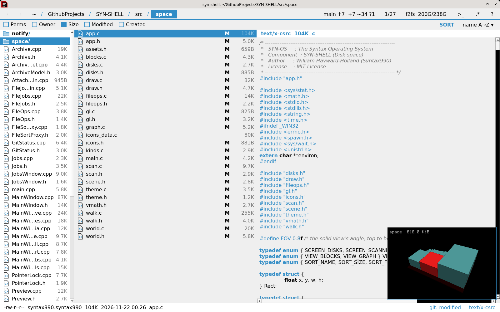
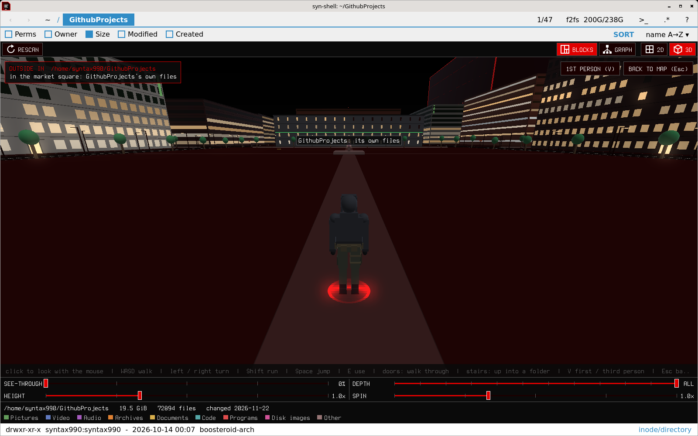
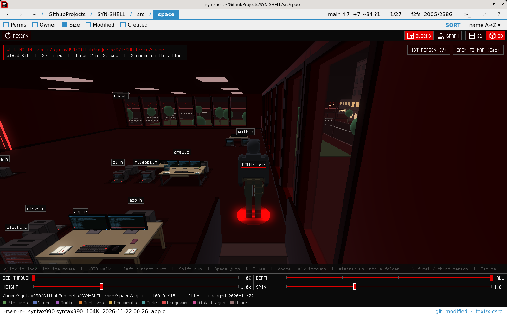
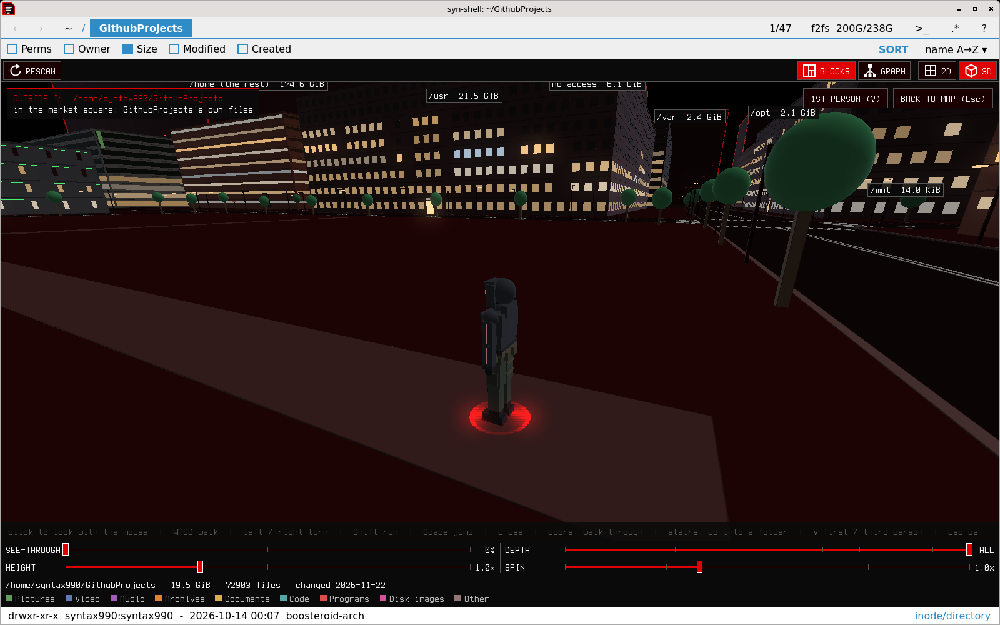
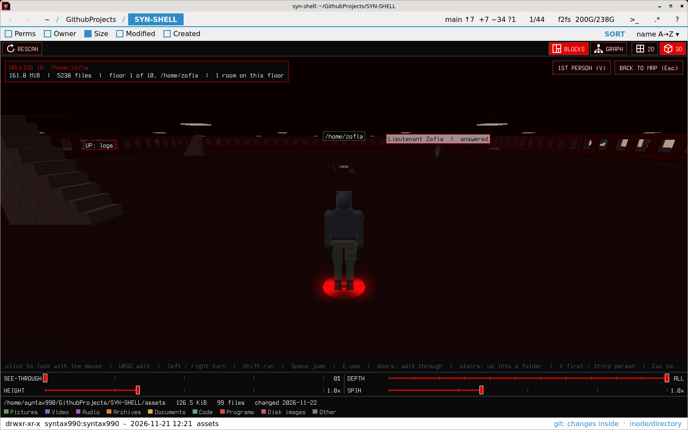

# SYN-SHELL

SYN-OS's own window onto the system: your files, the archives among them,
a shell, and where the disk space has gone, in one window laid out the way
ranger lays out a terminal. Three columns: the folder you came from, the
folder you're in, and a preview of whatever the cursor is on. The disk
space can be walked through too: the folder becomes a city, its folders
buildings, its files furniture.



- **Files**: ranger's keys (`j` `k` `h` `l`, `gg` `G`, `/`), marks, copy,
  move, rename, trash, with each job in the background. Every file wears a
  SYN-OS icon for what it is.
- **Archives** open like folders (libarchive): browse, extract, add.
- **A shell** in the window (libvterm), started in the folder you're in,
  that moves out to foot when you want it bigger.
- **Previews**: code highlighted (KSyntaxHighlighting), images, PDFs
  (poppler), video frames and audio tags (ffmpeg).
- **Disk space** ([docs/disk-space.md](docs/disk-space.md)):
  - A small render in the bottom right corner, there all the time while
    you browse: the folder you're in as 3D blocks, turning, growing as it
    is measured. `zr` (`:corner`) turns it off and on.
  - Click it (or `zv`, `:space`) and it fills the window: a block map or
    a node graph, flat or 3D. `Esc` puts it back in the corner.
  - `zt` (`:tree`): the left column becomes the folder tree, biggest
    first, with each one's size, share, file count and last change.
- **Walk mode** ([docs/walk.md](docs/walk.md)): the figure in the view's
  bottom right corner walks you into the folder.
  - The folder is a city. Its own files stand in the market square; each
    folder in it is a building, its folders the floors above, up the
    stairs; every room is sized to what stands in it.
  - Files are furniture of their kind: code at desks with screens,
    programs as computers and server racks, documents in bookcases, music
    round a rug, pictures on easels in the windows' light. `E` uses the
    one you face.
  - Beyond the city wall, the rest of the disk: a plain as wide as the
    disk at the city's scale, the disk's other folders standing on it as
    towers by their size.
  - The crew (SYN-CORP's agents) follow you as a crew; switched off on the
    app they rest at home, and with work running a worker of theirs types
    at their desk; what they say on the radio appears over them, the word
    being spoken boxed as on the phone. Nothing is sent to them.
  - Lit the way SYN-TREK is: what shines glows.
  - A radar, a car to drive (`E` at its door), sprinting, and sound made
    as it plays: steps, jumps, the engine, the doors.

| | |
|---|---|
|  |  |
| The city: the folder's own files in the square, its folders as buildings | A room: its files as furniture, arranged in rows and groups |
|  |  |
| Beyond the wall: the rest of the disk | A crew member in their office, their last action over them |

`?` in the window lists every key.

## Building

Linux:

```
makepkg -si
```

or by hand:

```
cmake -B build -DCMAKE_BUILD_TYPE=Release
cmake --build build
```

Needs Qt 6 (base), libarchive, libvterm, SDL2, SDL2_ttf and OpenGL 3.3;
KSyntaxHighlighting, poppler and ffmpeg are optional. `-DSYN_SHELL_TEST=ON`
adds options for driving the window from a script (`src/TestDrive.h`):
`--size WxH`, `--view`, `--view-script "wait:MS;goto:PATH;key:K;hold:K:MS;look:X,Y;click:X,Y;shot:FILE;report"`.

Windows: `build-windows.ps1` (MSYS2). The disk space columns and walk mode
are Linux only for now.

## What comes from elsewhere

- `src/notify/` is syn-bar-core's notify code from SYN-OS, so job results
  sound through the bar.
- `assets/themes/` are SYN-OS's themes, compiled in for the space view.
- `assets/SYNTerminal-Regular.ttf` is under the OFL (`assets/OFL-SYNTerminal.txt`).

Copy them again when SYN-OS changes them.

## Licence

MIT. William Hayward-Holland (Syntax990).
