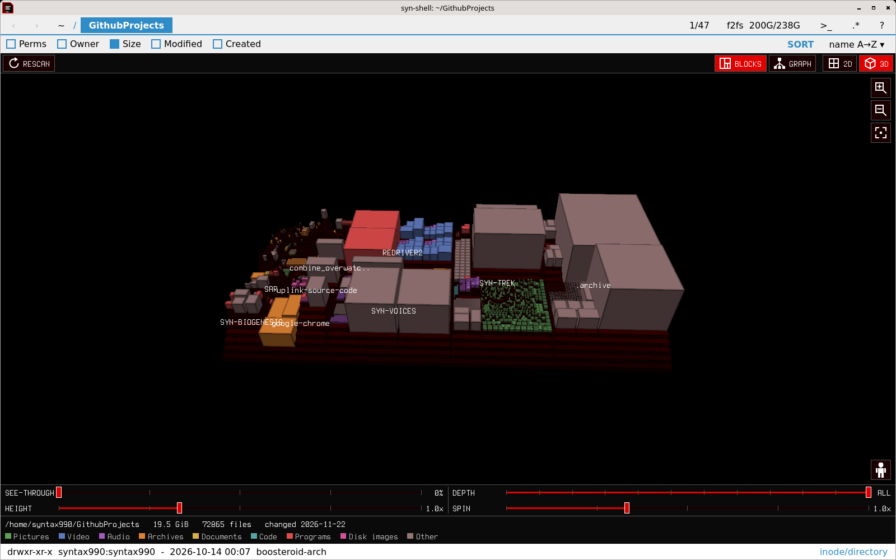
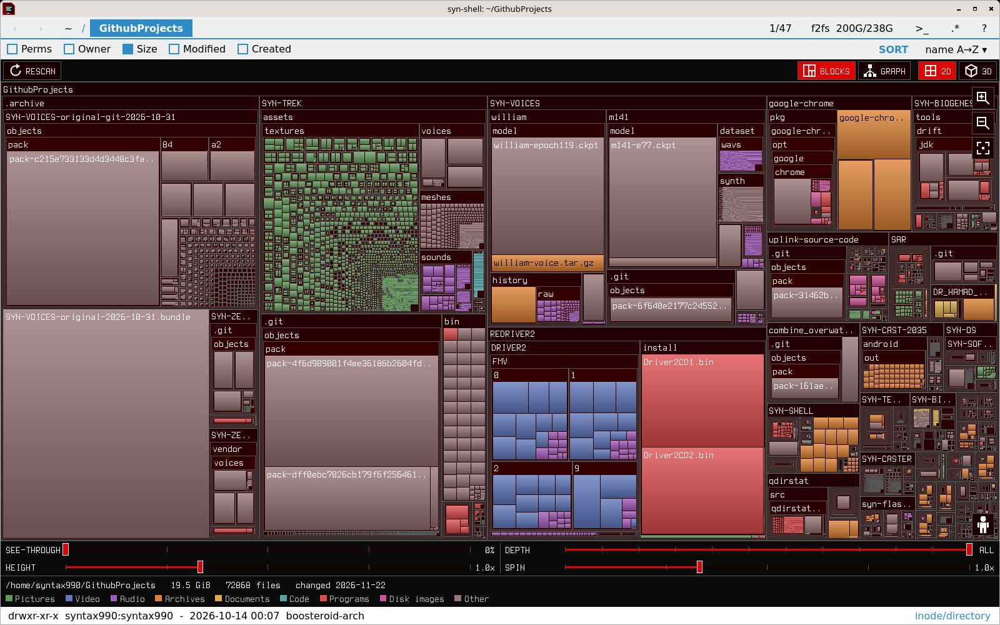
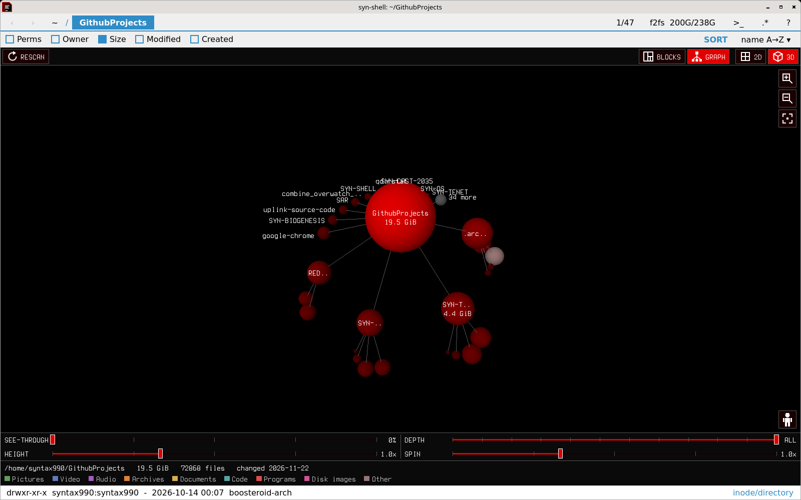

# Disk space

Where the space on a disk has gone. SYN-SHELL measures the folder you're
in (or a whole disk, or a mounted network share) and shows it three ways:
a tree list that sorts by any column, a block map where every file is a
rectangle as big as the space it takes, and a node graph of the biggest
folders that you walk into. The block map and the graph each turn between
2D and 3D. It wears the SYN-OS theme. It only reads: nothing is deleted or
moved from here.

It is in the line of TreeSize, SequoiaView, KDirStat, WinDirStat and
QDirStat (the list and the block map), Filelight and Baobab (walking in
from the middle) and SGI's fsn (the 3D). Walking through it as a city is
[walk mode](walk.md).

| | |
|---|---|
|  |  |
| The block map in 3D: folders are platforms, files stand on them, taller the bigger | The same flat: folders are frames with their names, files are blocks coloured by kind |
|  | |
| The node graph: the focus in the middle, its biggest children round it, theirs behind them | |

## In SYN-SHELL

| | |
|---|---|
| the corner | the folder you're in, in 3D, turning, growing as it is measured; `zr` or `:corner` turns it off and on |
| click the corner, `zv`, `:space` | the view fills the window; `Esc` puts it back in the corner |
| `zt`, `:tree` | the left column becomes the folder tree, biggest first |
| BLOCKS / GRAPH | the block map or the node graph |
| 2D / 3D | flat or solid |
| the figure, bottom right | [walk mode](walk.md), in the folder shown (drag it onto a folder to walk into that one) |
| click | select; going into a folder there moves the file columns there too |
| double-click | go into that folder |
| right-click, UP | back up |
| drag, wheel (in 3D) | turn the view, zoom; the buttons on the right zoom and fit |
| SEE-THROUGH, HEIGHT, DEPTH, SPIN | how see-through the blocks are, how tall, how many levels down, how fast it turns |

Hovering anything shows its name, size and share of the view; the bar at
the bottom has its whole path, file count and when it last changed.

Colours: a file's is its kind (pictures, video, audio, archives,
documents, code, programs, disk images, other), the key is at the bottom.
A folder in the graph is nearer the theme's accent the more of the picture
it holds. The selection is the theme's urgent colour.

## On its own

The same in a window of its own, with the list of disks first:

```
syn-shell --space                  start at the list of disks
syn-shell --space PATH             scan PATH at once
syn-shell --space --graph PATH     start in the node graph, not the block map
syn-shell --space --3d PATH        start in 3D
syn-shell --space --walk PATH      start in walk mode
syn-shell --space --theme NAME     wear this theme, e.g. SYN-OS-HALO-CYAN
syn-shell --space --levels N       start the DEPTH slider at N levels, 1 .. 11
syn-shell --space --height X       start the HEIGHT slider at X, 0 (flat) .. 3
syn-shell --space --spin X         start the SPIN slider at X times SYN-TREK's speed, 0 .. 3
syn-shell --space --dump PATH      print the tree as text, no window
syn-shell --space --depth N        how many levels --dump prints (default 2)
syn-shell --space --shot FILE.ppm  save the first picture and leave (--shot-at MS for a later one)
```

The first screen lists the disks and network shares the machine has
mounted, each with how full it is. Click one to scan it, or type a path
into the bar (click it or Ctrl+L, then Enter). R or F5 scans again; T and
Shift+T change the theme; Esc stops a scan and goes back to the disks.

## What a size is

- **Linux:** the space taken on disk (`st_blocks`), so a sparse file
  counts as what it really holds, and a folder's own blocks are counted.
  The total matches `du -s`. A file with several hard links is counted
  once per link (as `du -l`).
- **Windows:** the file's length, read from the folder's entries.
- Symbolic links are counted as themselves and never followed. A scan
  stays on the file system it started on: other disks mounted inside it
  are not walked.
- A folder that could not be opened is shown in the urgent colour and
  said in the bottom bar.

## How it's built

C11 in `src/space/`, drawn with OpenGL 3.3 inside SYN-SHELL's window (or
an SDL2 window of its own with `--space`). The few OpenGL calls newer than
1.1 are looked up at start (`gl.c`); the matrix maths is `vmath.h`.

**The scan** (`scan.c`) is plain C with no graphics and runs in its own
thread, so the view grows as it goes. Linux walks with `openat` and
`fstatat`.

**A view is a scene** (`scene.h`): a list of items, each a folder or file
with its flat shape and its solid one. `blocks.c` and `graph.c` build the
scene for the folder in focus; the view draws it flat or solid and finds
what the mouse is on either way.

- **The block map** is a squarified treemap (Bruls, Huizing and van Wijk,
  2000). It stops opening folders smaller than a few pixels, so the work
  is bounded by the window, not by the disk.
- **The node graph** puts the focus in the middle, its 14 biggest
  children on a ring (the rest as one "N more" ball) and each big child's
  own biggest behind it. A ball's area is its size, on one scale across
  the picture.

**The theme** is the desktop's. Every SYN-OS `.theme` file and the SYN
Terminal font are compiled in (`cmake/embed.cmake`). On SYN-OS it starts
in the theme that is applied (`~/.config/syn-os/current-theme`).

## Files

```
src/space/main.c      --space: the options, --dump
src/space/scan.c/.h   the tree and the walk that fills it
src/space/disks.c/.h  the mounted disks and shares
src/space/scene.h     an item, a scene
src/space/blocks.c    the block map's layout
src/space/graph.c     the node graph's layout
src/space/kinds.c     a file's kind and colour
src/space/app.c/.h    the view: disks, list, view, input
src/space/draw.c/.h   flat and solid drawing, the glow, text
src/space/gl.c/.h     the OpenGL calls looked up at start
src/space/vmath.h     vectors and 4x4 matrices
src/space/theme.c/.h  the built-in SYN-OS themes
src/space/world.c/.h  walk mode's city: buildings, floors, rooms, streets
src/space/walk.c/.h   walk mode: moving, the furniture, the crew, the rest of the disk
src/SpaceView.cpp     the view inside SYN-SHELL's window
```
