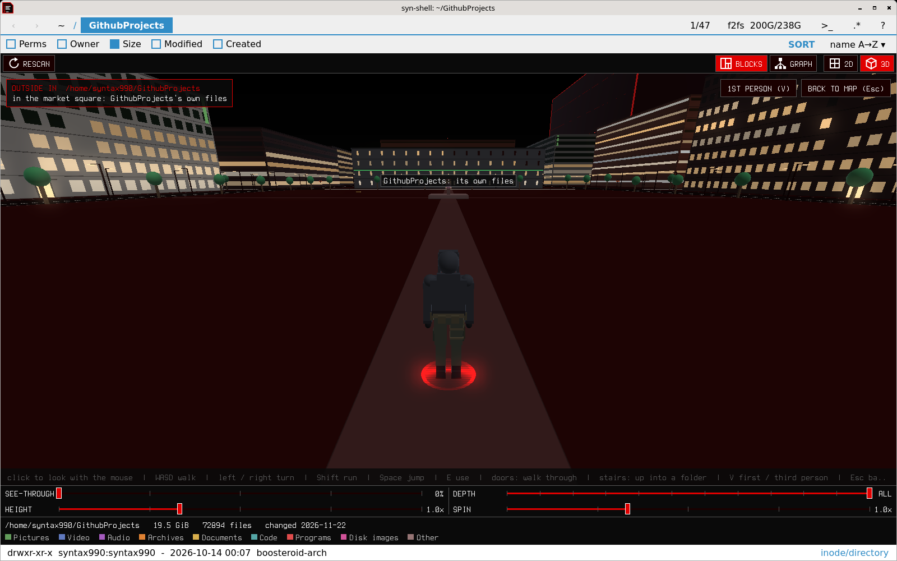
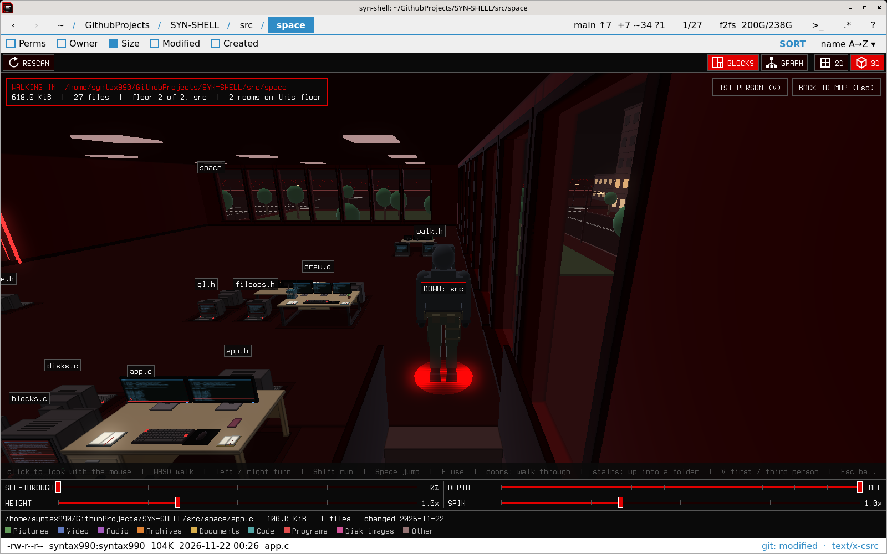
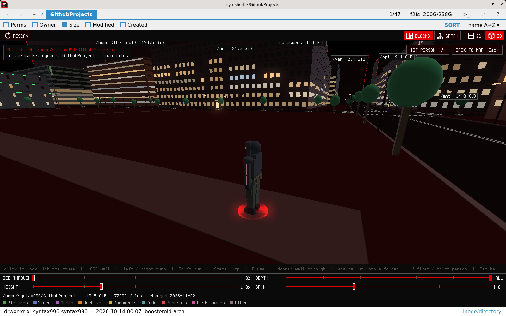
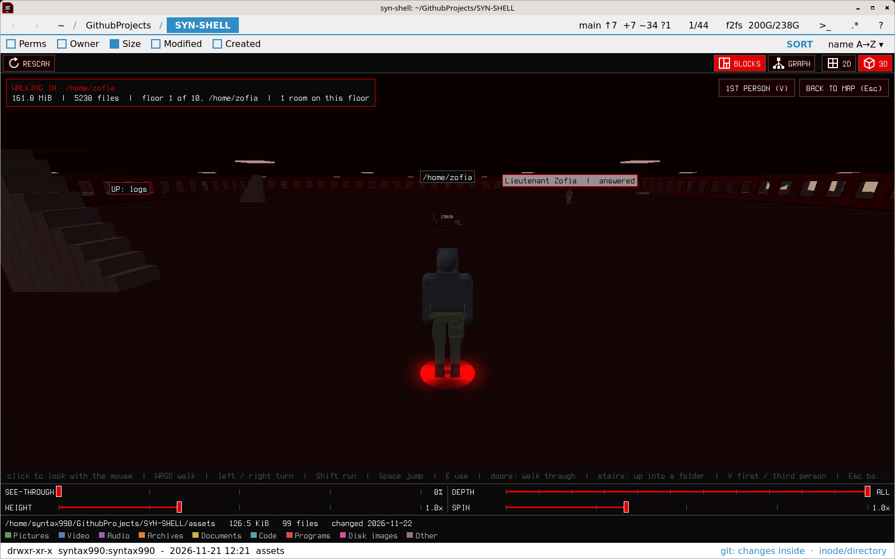

# Walk mode

The disk space you can walk through. The folder is a city: its own files
stand in the market square, each folder in it is a building, and inside,
every file is a piece of furniture of its kind, as big as the file is.
Beyond the city wall stands the rest of the disk. The crew are in their
offices. It only reads: nothing is moved, and nothing is sent anywhere.

## Getting in and out

In SYN-SHELL's disk space view (the corner, or `zv`), click the figure in
the bottom right corner to walk in the folder shown, or drag the figure
onto a folder to walk into that one. On its own: `syn-shell --space --walk
PATH`. `Esc` goes back to the map.

| | |
|---|---|
| click the view | look with the mouse |
| `W` `A` `S` `D` | walk |
| left / right | turn |
| `Shift` | run |
| `Space` | jump |
| `E` | use the file you face (open it, play it) |
| `V` | your own eyes, or over your shoulder |
| doorways | walk through into the next room |
| stairs | up into a folder: the rooms over a room are its folders |
| `Esc` | back to the map |

The file columns follow you: walk into a room and SYN-SHELL goes to that
folder too.

## The city

- **The market square** in the middle holds the folder's own files.
- **Each folder** is a building round it, the biggest nearest, with its
  name over the door. Inside, the ground floor is that folder's own files;
  its folders are the rooms on the floor above, cut from the floor below
  them, up the stairs, and theirs above those, up to twelve floors.
- **Folders too small** for a room of their own share a store room, its
  board listing them.
- **Every room is sized to what stands in it**: the floor its furniture
  wants, with a walkway round the walls, and room for the rooms above it.
  A folder of many small files gets the room to stand them in.
- Streets and avenues between the blocks, named after the folder, lamp
  posts and trees along them, and a wall round the whole city.

## Rooms and furniture

| A file that is | stands as |
|---|---|
| code | a terminal, or a desk of screens with its chair |
| a program | a tower, a desk with a computer, or racks of servers |
| a document | a desk with papers; big, a bookcase or a library stack |
| music | a boombox, a turntable, a hi-fi or a jukebox, round a rug in a lounge |
| a picture | an easel in a window's light, or a picture on a stand |
| a video | a set, a screen on a cabinet, or a cinema screen and projector |
| an archive | crates, filing cabinets, crates on a pallet |
| a disk image | a drive with its lid off, an enclosure of bays |
| anything else | boxes |

The room arranges itself: the library, screens, storage and computers
against the walls, clear of the windows and doorways; the rest out on the
floor in groups of their kind (desks facing each other, racks and stacks
in rows, music round its rug, a gallery facing across an aisle), with
aisles between. Each piece faces its own way. One scale in every room:
4 KiB and under knee high, 4 GiB and over 2.8 m. A room shows its biggest
300 files; the panel top left counts the rest.

## You

A man in a hoodie, the hood up over a balaclava, his eyes glowing in its
slit; a snood, a tactical belt with its pouches, a drop-leg holster,
cargo trousers with knee pads and boots. Piping in the theme's colour.
He stands on the ring he was spawned from.

## Beyond the wall: the rest of the disk

Round the city, out to a plain as wide as the disk would be at the city's
scale (so the city's share of the plain is the folder's share of the
disk), glowing grid to its edge. The edge is a line of light, named with
the disk's size and how much is free.

On the plain stand the disk's other top-level folders as towers, each as
big as it is: `/usr`, `/var`, `/opt`, and the folder the city is in as
"the rest" of it. What is used but could not be read (other users'
homes, root's) is one tower, "no access". Only the disk the city is on:
other disks and `/proc`, `/sys`, `/dev`, `/run` and `/tmp` are left out.

They are measured once, in the background (about two minutes for a full
disk), and kept a day in `~/.cache/SYN-OS/syn-shell/beyond`; until then the
plain says it is measuring.

## The crew

When the city is your home folder, or a folder in it, each of the crew
(SYN-CORP's agents) has their home standing at the city's edge as their
office, `OFFICE:` and their name over the door. Inside, they are there:
a figure like you in their own colour, their name over them.

- **About the office**: walking from file to file and stopping to read.
- **In a turn**: at their desk. That is SYN-CORP running a turn for them
  (a `corp-turn-NAME` unit), read from `systemctl` every few seconds.
- **What they last did** shows a minute over them: answered, a commit and
  its repository, a ticket, from `~/.local/state/syn-corp/syn-corp.log`.

Their homes are scanned when you first walk (each is its own tree: the
file columns stay where they are when you walk into an office). Only what
your account can read is shown. Nothing is asked of them and no turn is
run: it costs nothing.

## Light

Lit the way SYN-TREK spends its light: the view is drawn into a buffer of
its own, its bright parts (windows, lamps, screens, lines of light, eyes)
taken out at half size, blurred wider each pass and added back as glow;
the sides of things turned from you catch a rim of light. Far off, the
city fades into the night and the far plane reaches the disk's edge.

## For trying it

| | |
|---|---|
| `SYN_WORLD_DUMP=1` | print each building (its footprint, floors, rooms, files and the floor they want) and the disk measuring |
| `SYN_SHELL_FPS=1` | frames a second while walking, on stderr |
| `SYN_CREW_TEST=NAME` | straight into that crew member's office once it stands |

With the test build (`-DSYN_SHELL_TEST=ON`), `--view-script` drives it:
`goto:PATH` walks into a folder, `hold:w:2000` walks for two seconds,
`look:X,Y` turns, `shot:FILE.png` saves the window.
