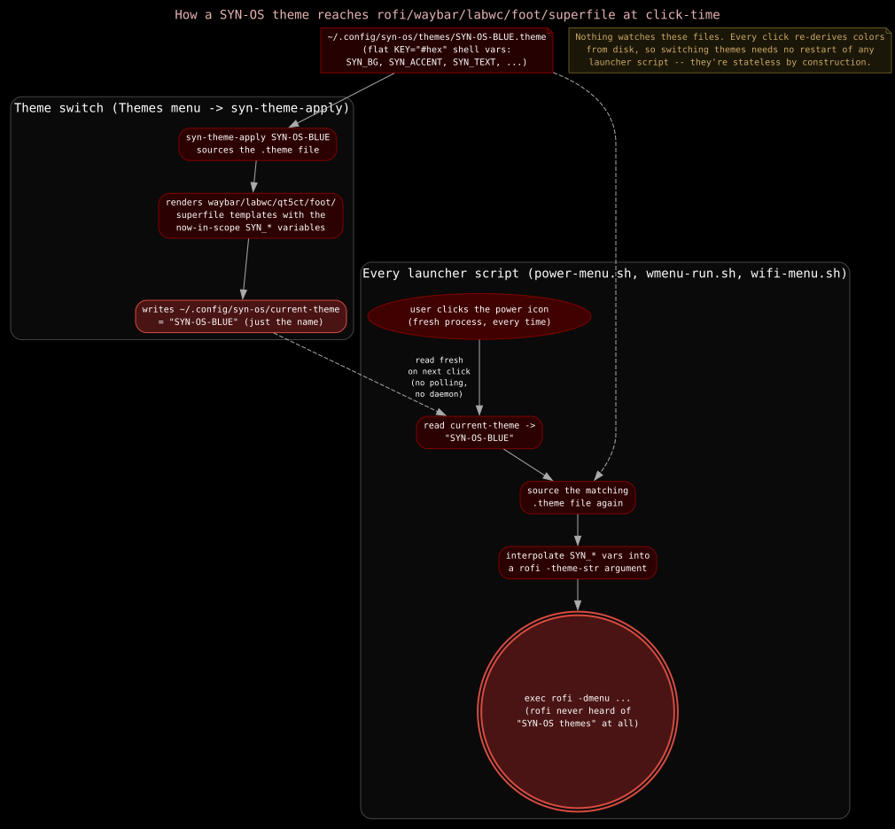

# LabWC: Window Manager

[LabWC](https://github.com/labwc/labwc) is the compositor/window-manager SYN-OS runs on Wayland, the Openbox-alternative mentioned in the README. It's Openbox-style deliberately: LabWC reuses Openbox's theme format and a similar XML config structure, so if you've configured Openbox before, the files below will look familiar.

Config lives at `DotfileOverlay/etc/skel/.config/labwc/`, deployed to `~/.config/labwc/` on the installed system.

## Key files

**`rc.xml`**: the main config: theme selection, virtual desktops, mouse bindings, and keybinds. As shipped:

- Theme: `SYN-OS-RED` (see [Dotfile Overlay](./dotfile-overlay.md) for where theme files live), Terminus font throughout.
- 4 virtual desktops, named with glyphs: `🃁 [Terminal]`, `ℐ [Web]`, `ℕ [Media]`, `⌘ [External]`. These names are echoed in Waybar's `wlr/workspaces` module icons (see [Waybar](./waybar.md)).
- Mouse: `Alt+Left` drag to move, `Alt+Right` drag to resize, `Alt+Middle` to lower.
- Keybinds include: `Super+Space` opens the root menu, `Super+Return` opens a terminal (`foot`), `Super+q` closes the focused window, `Super+Tab` toggles maximize, `Alt+Tab`/`Alt+Shift+Tab` cycles windows, `Super+1..4` jumps to a desktop, `Ctrl+Alt+Left/Right` and `Shift+Alt+Left/Right` move between/send-to desktops, `Super+p` screenshots a selected region with `grim`+`slurp` into `~/Pictures/Screenshots/`.

  `rc.xml` binds `Super+a` to launch `fuzzel` (an alternate launcher alongside `wmenu`, which is what Waybar's glyph module and the wifi-menu script invoke).

- `Super+l` locks the screen with `swaylock`. Both `fuzzel` and `swaylock` are in [`SYNSTALL`](./packages.md)'s `desktopStack`.

**`autostart`**: runs when the `synos` alias launches the session (see [Zsh Configuration](./zsh.md)): sets the wallpaper via `swaybg` and starts `waybar`. Comment in the file notes this is the LabWC equivalent of Openbox's `~/.config/openbox/autostart`.

**`environment`**: sets process environment for the LabWC session; currently just `QT_QPA_PLATFORMTHEME=qt5ct` so Qt apps pick up the qt5ct-configured theme instead of a mismatched default.

**`menu.xml`**: the root menu shown by `Super+Space`. Deliberately kept to SYN-OS's own tools and system actions rather than a generic app-launcher list — third-party apps belong in "All Applications" (a dynamic `xdg_menu` pipe), not hardcoded here. Structure:
  - **Applications**: Terminal, File browser, All Applications (dynamic).
  - **SYN-OS Tools**: SYN-SHARE, SYN-NETCLIENT, SYN-NETSERVER (via `doas`), SYN-CRYPTER, SYN-REDSHIRT — the last two are wrapped as `foot -e zsh -c '... ; exec zsh'` rather than launched directly, since they take CLI args/flags and would otherwise flash-open-and-exit with a usage error.
  - **System Control**: Lock Screen, Screenshot (select area), Volume Mixer, a **Kill Process** submenu (Close Focused Window, plus `pkill` entries for `foot`/`falkon`/`spf` — kept to a short known list on purpose, not a full process browser), Audio Settings and Display & Screens (both dynamic pipe menus), and Themes (live theme switch, see below).
  - **Configuration**: Edit Configuration Files (Waybar config/style, LabWC menu/rc/autostart — each just opens the file in `featherpad`).
  - **Interface**: Waybar & LabWC (reload/kill/relaunch either).
  - **Power**: Reboot, Power Off.

**`syn-theme-menu.zsh`**: dynamic pipe menu backing the "Themes" entry above — lists the theme files under `~/.config/syn-os/themes/`, marks the active one, and an "Edit Themes Folder" entry. Selecting a theme runs `syn-theme-apply`, which sources that `.theme` file's `SYN_*` shell variables and re-renders the Waybar/LabWC/qt5ct/foot/Superfile templates from them.

### How a theme reaches every consumer

Nothing watches these files and there's no daemon: `syn-theme-apply` writes `~/.config/syn-os/current-theme` (just the theme name) once, and every launcher script (`power-menu.sh`, `wmenu-run.sh`, `wifi-menu.sh`) re-reads that name and re-sources the matching `.theme` file fresh on every invocation. That's why switching themes needs no restart of any of those scripts — they're stateless by construction, and picking up a new theme is just "the next click happens after the switch."

**`themerc`**: the `SYN-OS-RED` Openbox-format theme definition (colors, borders, button styles) that `rc.xml` references by name; the actual theme files live under `usr/share/themes/SYN-OS-RED/openbox-3/` in the overlay (see [Dotfile Overlay](./dotfile-overlay.md)).

**`labwc-audio-menu.zsh`, `labwc-wlr-menu.zsh`, `spf-menu.zsh`**: helper scripts invoked from menu entries for audio device selection, output/monitor management, and launching the Superfile file manager.

## Customizing

Edit `rc.xml` for keybinds/theme/desktops, then either `Super+Escape` (bound to `Reconfigure`) to reload without restarting the session, or log out/in. Remember these are dotfile *templates*: changes here only reach a real system through [`DotfileOverlay`](./dotfile-overlay.md) at install/rebuild time, not by editing a running system's `~/.config/labwc/` directly (that copy is independent once deployed).
