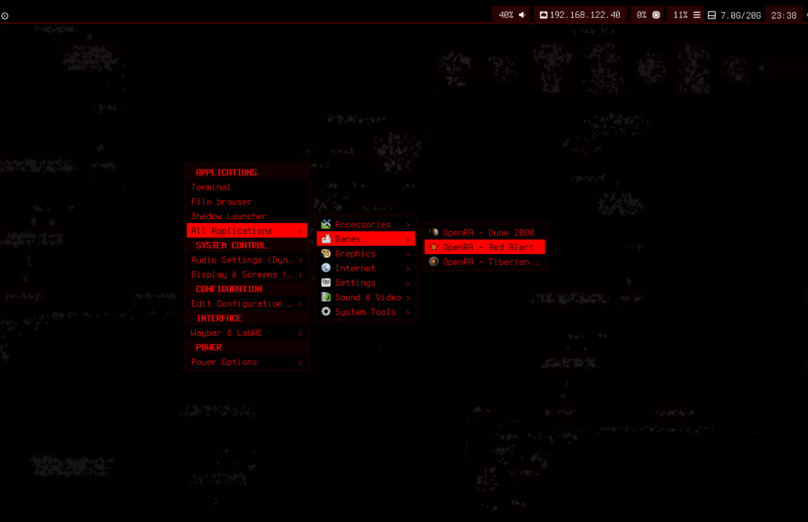
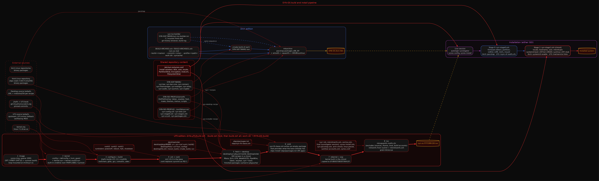
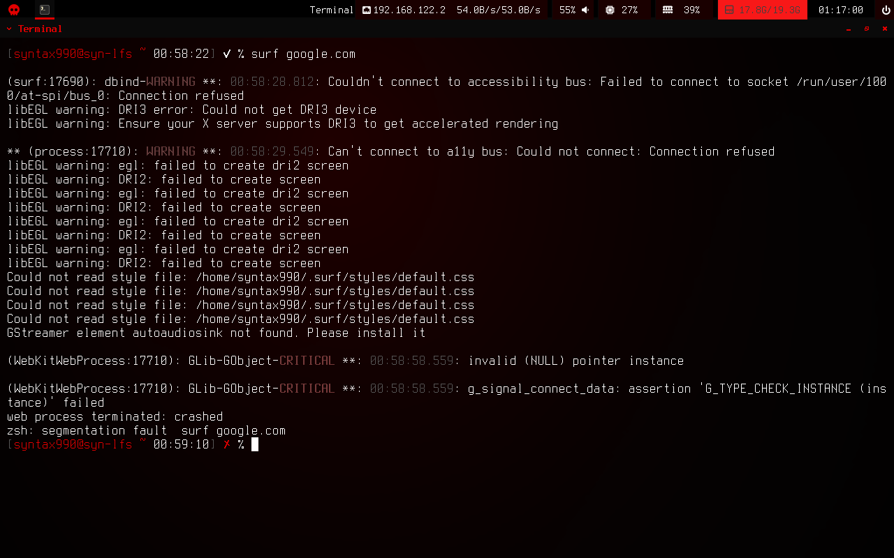
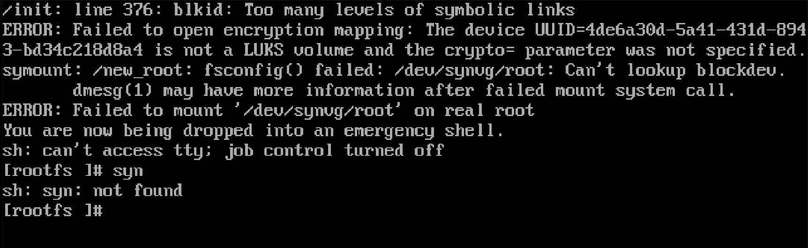
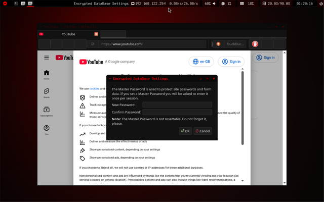

# SYN-OS

A Linux desktop by William Hayward-Holland (Syntax990).



SYN-OS is its dotfiles and its applications: labwc, waybar, foot and mako configured as one desktop, 63 live themes, and a set of native tools written for it (syn-bar, syn-connect, syn-shell, syn-hum, syn-relay, syn-crypter, syn-wallgen and others, under [SYN-SOFTWARE](./SYN-SOFTWARE)). One answers file, `synos.conf`, drives the installer.

## Arch or LFS

The same desktop is built on one of two bases:

| | Arch | LFS |
|---|---|---|
| Base | Arch Linux | Linux From Scratch 13.1, compiled, with SYN-OS's own kernel |
| Init | systemd | runit |
| Packages | pacman | Void Linux's, through xbps, or compiled from source |
| Build | minutes | hours, with 60 GB free |

Both give a bootable ISO with a live session and the same installer: UEFI or BIOS, systemd-boot, rEFInd, GRUB or syslinux, LUKS2, LVM, and ext4, f2fs, btrfs or xfs.



Source: [docs/diagrams/src/syn-os-build.dot](./docs/diagrams/src/syn-os-build.dot) · [SVG](./docs/diagrams/svg/syn-os-build.svg)

## Build an ISO

On an Arch Linux machine:

```bash
git clone https://github.com/syn990/SYN-OS.git && cd SYN-OS
zsh BUILD.zsh                  # what it can build
zsh BUILD.zsh syn-os-arch      # SYN-OS on Arch
zsh BUILD.zsh syn-os-lfs       # SYN-OS on LFS
```

Each name is a file in [SYN-EDITIONS](./SYN-EDITIONS):

| Edition | Builds |
|---|---|
| `syn-os-arch` | SYN-OS on Arch Linux |
| `syn-os-lfs` | SYN-OS on LFS, the desktop from Void's packages |
| `syn-os-lfs-source` | SYN-OS on LFS, every desktop package compiled |
| `arch-releng` | Arch's own installation ISO, unchanged |

Before an LFS edition's first build, `zsh BUILD.zsh syn-os-lfs host` installs what it needs. If an LFS build stops, run it again and it carries on from the step that stopped. `zsh BUILD.zsh check NAME` says what a build would run and anything stopping it; `zsh BUILD.zsh status NAME` says how far one has got. To build it another way, copy an edition and change it.

The ISO Builder (SYN-OS ISO Builder in the desktop menu) lists the same editions, with how far each has got, and builds the one you pick.

## Install

Boot the ISO, then:

```bash
synos-config     # edit /etc/syn-os/synos.conf
synos-install    # asks for anything left at CHANGE_ME, confirms, wipes the disk
```

## From the LFS stream's development

| | |
|---|---|
|  |  |
| surf on an early LFS image, before GStreamer's audio plugins were built | The installed system's initramfs, before `/usr/sbin` was merged into `/usr/bin` |
|  | |
| The SYN desktop on the LFS base, runit and Void applications | |

## Read more

- [The full notes](./docs/README-full.md): installing, building, the package set, every tool, theming, and the documentation index.
- [SYN-LFS](./SYN-LFS/README.md): the LFS stream in detail, and what comes next.
- [Why SYN-OS exists](./SYN-ISO-PROFILE/airootfs/usr/share/syn-os/docs/philosophy.md) · [Project history](./SYN-ISO-PROFILE/airootfs/usr/share/syn-os/docs/history.md)

MIT licensed, see [LICENSE](LICENSE). Contact: william@npc.syntax990.com
